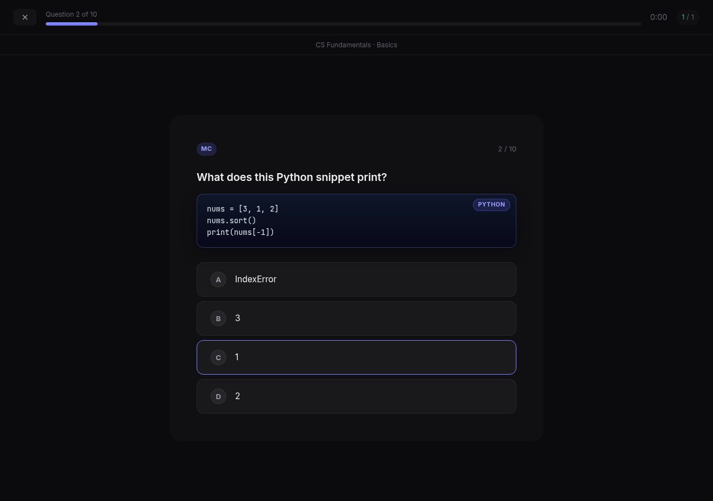
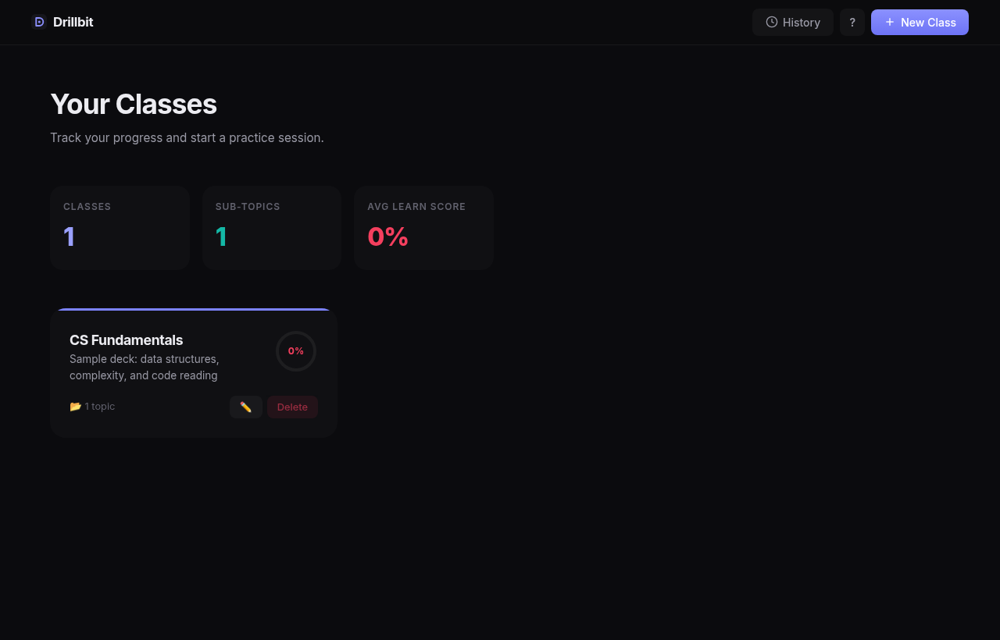

# Drillbit

A small, local-first study app. Organize questions into classes and topics, drill them in practice sessions, and watch your mastery go up. Everything runs on your own machine with Express and plain JavaScript, so there is no build step and no account.



## Features

- **Classes and topics.** Group your decks by course, then split them into topics.
- **Question types.** Multiple choice, true/false and flashcards, mixed freely in one deck.
- **Markdown with code.** Questions and explanations support fenced code blocks (rendered in JetBrains Mono with a language label), inline code and bold text.
- **Practice and exam modes.** Shuffle or focus on your weakest questions, limit the session length, or run a timed exam.
- **Progress tracking.** A learn score per question, topic and class based on your recent answers, plus a session history with a heatmap.
- **Fast editing.** Add questions without leaving the topic page, duplicate and reorder them, and attach images or short videos by drag and drop or paste.
- **Keyboard first.** Press `?` anywhere to see every shortcut.
- **Picks up where you left off.** The dashboard offers to reopen the last class and topic you studied.



## Getting started

You need Node.js 18 or newer.

```bash
git clone https://github.com/ungleicch/drillbit.git
cd drillbit
npm install
npm start
```

Then open http://localhost:3000. On the first run Drillbit creates a sample class, "CS Fundamentals", so you have something to try right away.

Settings via environment variables:

| Variable | Default | Purpose |
| --- | --- | --- |
| `PORT` | `3000` | Port to listen on |
| `DRILLBIT_DATA_DIR` | `./data` | Where classes, questions and progress are stored |
| `DRILLBIT_NO_SEED` | unset | Set it to skip the sample class on first run |

`npm run dev` restarts the server whenever you change a file.

## Keyboard shortcuts

| Where | Keys | Action |
| --- | --- | --- |
| Anywhere | `?` | Show the shortcut list |
| Anywhere | `G` then `H` | Dashboard |
| Anywhere | `G` then `S` | Session history for the last class |
| Anywhere | `C` | Continue the last class or topic |
| Dashboard | `N` | New class |
| Topic page | `N` | New question |
| Question editor | `Cmd/Ctrl + Enter` | Add and start the next question |
| Session | `1` to `9` or `A` to `D` | Pick an answer |
| Session | `T` / `F` | True / False |
| Session | `Space`, then `X` / `V` | Flip a flashcard, then grade it wrong / right |
| Session | `Enter` or `→` | Next question |
| Session | `←` | Previous question in exam mode |
| Session | `Esc` | Quit the session |

## Adding your own questions

Open a topic and either add questions one by one or upload a `.json` file. A file must be an array of question objects. See [`examples/cs_fundamentals.json`](examples/cs_fundamentals.json) for a complete deck.

```json
[
  {
    "type": "multiple-choice",
    "question": "Which data structure does BFS use?",
    "options": ["Stack", "Queue", "Heap", "Hash set"],
    "answer": "Queue",
    "explanation": "BFS visits nodes in the order they were discovered."
  },
  {
    "type": "true-false",
    "question": "Binary search needs sorted input.",
    "answer": "true"
  },
  {
    "type": "flashcard",
    "question": "What does `git rebase -i` let you do?",
    "answer": "Reorder, squash, edit or drop commits interactively."
  }
]
```

| Field | Required | Notes |
| --- | --- | --- |
| `type` | yes | `multiple-choice`, `true-false` or `flashcard` |
| `question` | yes | Markdown. Use triple backticks with a language name for code blocks |
| `answer` | yes | For multiple choice, the exact text of the right option. For true/false, `"true"` or `"false"`. For flashcards, the back of the card (Markdown) |
| `options` | multiple choice | Array of answer strings, shown in random order |
| `explanation` | no | Shown after answering. Markdown |
| `mediaUrl` | no | Image or video shown above the question |
| `id` | no | Generated automatically when missing |

Uploading appends to the topic, so you can import several files into one topic.

## Where your data lives

Everything is stored as plain JSON under `data/`:

```
data/
  classes.json                 class index
  classes/<classId>/
    meta.json                  name, description, color
    topics.json                topic index
    topics/<topicId>/
      questions.json           your questions
      progress.json            answer history per question
    sessions/                  finished sessions
```

Uploaded media goes to `public/uploads/`. Both folders are gitignored, so your decks and progress never end up in a commit. Back up `data/` to keep your work.

## License

[MIT](LICENSE)
